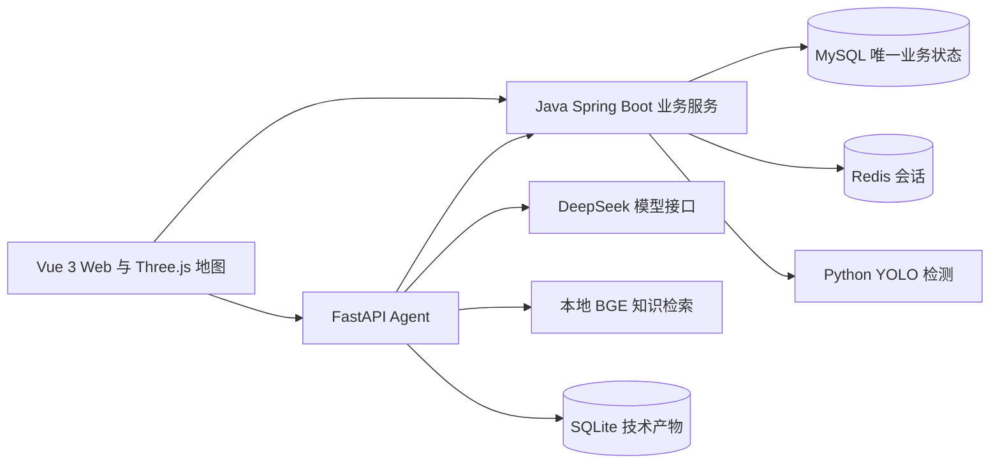

# SkyTwin AI

面向低空巡检的 AI 辅助数字孪生与协同处置平台。通过 Web 工作台连接图片分析、知识问答、发现复核、事件响应、调度预览、飞行仿真与证据归档。

本仓库是看客团队参赛项目的源码。GitHub 托管代码；在线演示由团队电脑和国内 HTTPS 隧道提供，仓库本身不会运行 Java、数据库或模型。

## 主要功能

- 三维态势：资源、电量、任务、航线、空域与仿真轨迹。
- 自然语言 Agent：查业务对象、查规程、生成调度预览；业务动作由操作者确认并由 Java 验收。
- 两类视觉：YOLO 返回检测框供人工复核；DeepSeek 图片对话提供候选观察、不确定性与同图追问。
- RAG：中文本地向量与关键词检索、依据展开、账号知识导入、版本更新和删除。
- AI 工作台：检查点恢复、模型与工具实际调用轨迹、Token、检索及 Agent 对照。
- 业务闭环：发现 → 复核 → 事件 → 侦察任务 → 方案 → 仿真 → 后图与报告；另含物流、通勤、维护等扩展示范。

## 技术架构



Java 拥有任务、资源、订单和事件状态；Agent 的 SQLite 保存运行与知识技术记录。`backend/` 是保留的旧 FastAPI Demo，日常不启动它来维护第二套任务。

## 安装与体验

详见 [安装运行指南](docs/INSTALL.md)。推荐先在独立目录安装依赖，再按指南配置本机路径，使用新建的项目专用数据库。完整主系统首次配置需要 Node、JDK、Maven、MySQL、Redis、Python，不是下载后直接双击运行。

| 入口 | 本机地址 |
|---|---|
| 指挥大屏 | http://127.0.0.1:5173 |
| 若依管理端 | http://127.0.0.1:5174 |
| Java / Agent | 127.0.0.1:8081 / 127.0.0.1:8002 |
| 专用 MySQL / Redis | 127.0.0.1:3307 / 127.0.0.1:16380 |

```powershell
# 已完成首次环境配置后，从仓库根目录启动
powershell.exe -NoProfile -ExecutionPolicy Bypass -File .\ruoyi\scripts\start.ps1
```

无需 Java 的独立样例见 [deploy/README.md](deploy/README.md)，仅运行合成业务和本地检索，不等同真实模型调用。国内公网入口见 [部署指南](deploy/DOMESTIC_DEMO_GUIDE.md)，随机地址以团队当前说明为准。评审账号由团队单独提供，密码和密钥不放入仓库。

## 目录与文档

| 目录或文件 | 内容 |
|---|---|
| `frontend/`、`shared/` | Vue 三维指挥界面及共享协议 |
| `ruoyi/` | Java、管理前端、SQL、Windows 配置和启动脚本 |
| `agent/` | Agent、RAG、看图、知识库、工作台与隔离测试 |
| `ai/` | YOLO 数据与训练/推理工具；模型、原始数据另行恢复 |
| `deploy/` | 本机样例、国内同源 HTTPS 入口和验证工具 |
| [架构与选型](docs/ARCHITECTURE.md) | 技术职责、集成与优化 |
| [模型与数据恢复](docs/MODEL_DATA.md) | 不在 Git 中的资源与校验方式 |
| [第三方来源](THIRD_PARTY_NOTICES.md) | 框架、模型、数据及三维素材来源 |
| [开发记录说明](docs/DEVELOPMENT_HISTORY.md) | 当前快照与历史记录边界 |

## 验证与实现边界

已有记录见 `docs/verification/`，以及 [AI 业务增量](docs/AI_WORKFLOW_V2.md)、[工作台](docs/AI_ENGINEERING_WORKBENCH.md)、[图片对话](docs/DEEPSEEK_IMAGE_CHAT.md)。记录有日期和范围，隔离替身测试不等于真实模型或实机验收。

- 实际模型接口与本地 YOLO 可以进行真实计算；飞行、车流和定位链路含仿真。
- 尚未接入实机飞控、空管审批或现场自主清理。历史 HAIDA 测试不能代表杭州现场准确率。
- 新电脑完整安装、多用户操作和外部模型领域效果还需扩大验证。
- `.github/workflows/quality.yml` 配置前端、Agent 隔离测试和 Java 编译；远端运行结果以 GitHub Actions 实际记录为准。

## 代码规范

- 代码与文档统一使用 UTF-8，基础缩进和行尾规则见 `.editorconfig`。
- Vue/TypeScript 以类型检查和生产构建为基础门禁；Python 以隔离单元测试为门禁；Java 以 Maven 编译打包为门禁。
- 提交前可在仓库根目录执行 `npm.cmd run build --prefix frontend`、`python -m unittest ...` 和 `mvn -B -ntp -f ruoyi/backend/pom.xml -DskipTests package`；完整命令见 `.github/workflows/quality.yml`。

## 团队

| 项目 | 信息 |
|---|---|
| 团队 | 看客 |
| 院校 | 重庆科技大学 |
| 成员 | 叶俊豪、邓怡恒 |
| 指导老师 | 李忠 |

项目已参加或提交第十二届中国研究生智慧城市技术与创意设计大赛，截至 2026 年 11 月 17 日尚未获奖。本次继续完善 AI WEB 相关功能。

## 来源与许可

若依登录、权限、菜单与框架并非团队从零开发，原 MIT 许可证随源码保留。自研增量为业务建模、受控 AI 编排、证据关联、调度交互与工程验证。依赖、模型、数据、地图和素材分别受各自许可约束，详见 [第三方来源说明](THIRD_PARTY_NOTICES.md)，不将某一组件的许可概括为全部作品许可。
